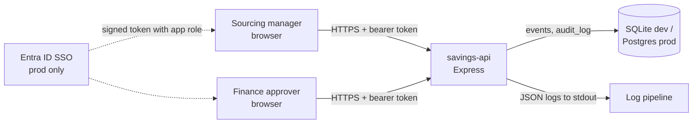

# Permit to Operate: TSC Savings Tracker

> **Draft for reviewers, not an approval.** Devin prepared this from the code in this PR so
> security, privacy and finance reviewers start from facts, not a blank page. A human owner
> signs off. All data in this repo is synthetic.

| | |
|---|---|
| System | TSC Savings Tracker (`savings-api` + web UI) |
| Ticket | TSC-101 |
| Owner | TSC Sourcing Engineering (to confirm) |
| Environment | Container (see `Dockerfile`), SQLite locally, Postgres in production via `DATABASE_URL` |

## 1. What it does

Sourcing managers log negotiated savings against a baseline price. Finance approvers review and
approve them. Only approved savings count toward the reported total. Every write is audited.

## 2. Data flow

## 3. Data touched

| Data | Table | Sensitivity | Notes |
|---|---|---|---|
| Supplier name, category, baseline and negotiated price, date | `events` | Commercially confidential | No personal data about suppliers |
| Creator and approver user names | `events`, `audit_log` | Internal (employee identifiers) | User IDs only, no email or HR data |
| Cost center code | `events` | Internal | Set by the server at approval time |
| Audit trail: actor, role, action, timestamp, detail | `audit_log` | Internal, compliance record | Append only from the app; no delete endpoint |

No customer data, no payment card data, no credentials stored. Logs carry request method, path,
status, latency, user name and error stacks; they never carry tokens or request bodies.

## 4. Roles and access

| Capability | `sourcing_manager` | `finance_approver` |
|---|---|---|
| View events, summary | Yes | Yes |
| Create savings event | Yes | No |
| Edit own pending event | Yes | No (not owner) |
| Approve event | No | Yes |
| View audit log | Yes | Yes |

The demo uses a mock sign-in (`POST /api/login`) that issues a signed JWT. In production this is
replaced by Entra ID SSO. The app trusts the Entra-issued token and maps app roles:

| Entra app role | App role |
|---|---|
| `TSC.SourcingManager` | `sourcing_manager` |
| `TSC.FinanceApprover` | `finance_approver` |

Role checks run on the server for every request (`server/auth.ts` `requireRole`). The UI hides
buttons, but the server is the control.

## 5. Human-in-the-loop controls

- Savings do not count until a finance approver approves them (`GET /api/summary` totals approved only).
- Approval is a separate endpoint restricted to `finance_approver`.
- Approved events are locked against edits (HTTP 409).
- Server-side validation (`server/validation.ts`): negotiated price must be below baseline,
  prices positive and capped, known category, date not in the future.
- Every create, edit and approval writes an audit row with actor, role, action and timestamp.

## 6. Test evidence

| Evidence | Where |
|---|---|
| API unit tests (validation, approved-only totals, cost center, audit) | `tests/api.test.ts` |
| RBAC tests (no token, forged token, finance cannot create, manager cannot approve, ownership, locking) | `tests/rbac.test.ts` |
| End-to-end: sourcing manager submits, finance approves, audit shows both | `e2e/approve-flow.spec.ts`, recording on the PR |
| CI: lint, typecheck, unit, e2e, Docker build and smoke test | `.github/workflows/ci.yml` |

## 7. Open items for reviewers

- Replace mock sign-in with Entra ID token validation before go-live.
- Set `JWT_SECRET` (or Entra config) from the platform secret store. The server refuses to start in production without it.
- Confirm log retention and where `savings-api` logs land.
- Confirm backup policy for the production Postgres database.
